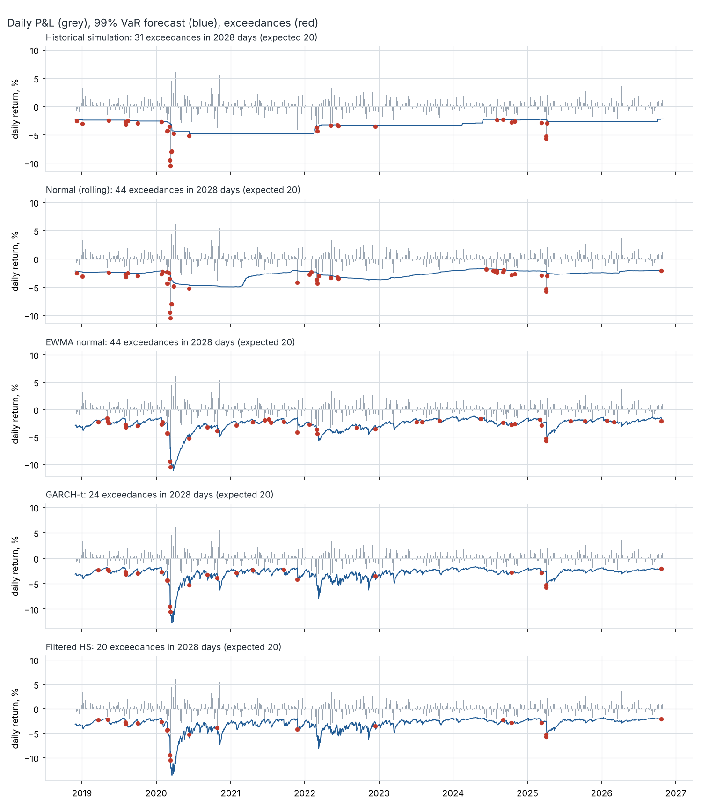
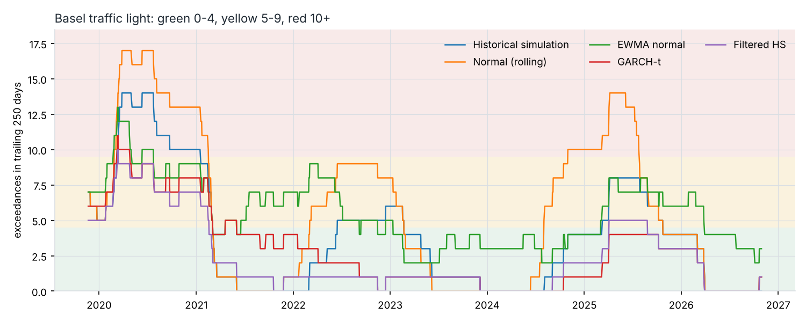
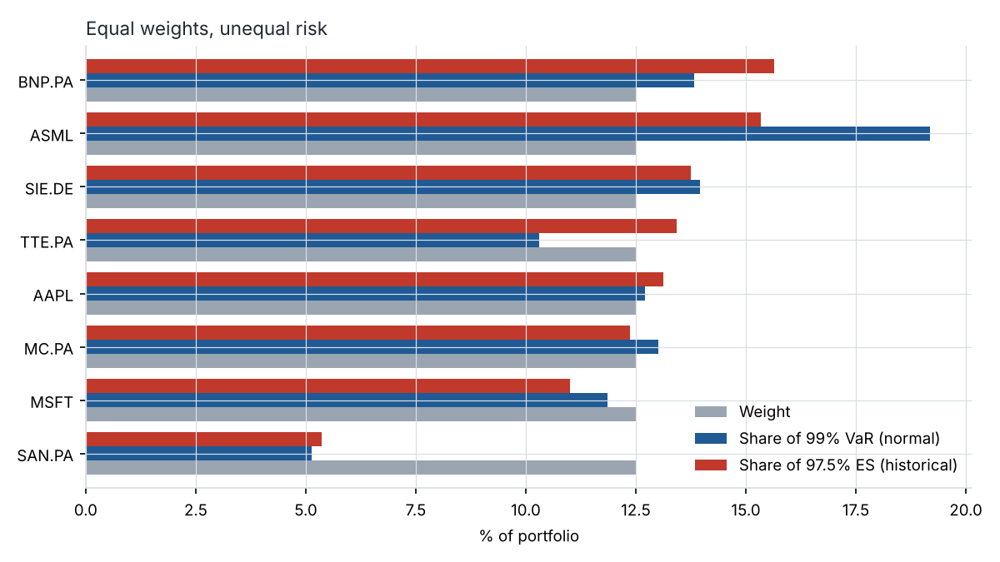

# Market Risk Engine: VaR and Expected Shortfall, backtested out of sample

[](https://github.com/davidepellegrino-stack/portfolio-risk-analyzer/actions/workflows/ci.yml)

Five ways to forecast one-day 99% VaR and 97.5% Expected Shortfall for an equity portfolio, each tested against 2,028 days of realised P&L with the backtests a bank's model validation team would run.

**Result.** The two normal models are rejected: 44 exceedances where 20 are expected. Plain historical simulation is rejected too. GARCH with Student-t tails and filtered historical simulation get the number of exceedances right (24 and 20), but their exceedances still cluster in March 2020 and April 2025, so neither passes every test cleanly.



## Portfolio and data

Eight large caps at equal weight: Apple, Microsoft, ASML (Nasdaq listing), LVMH, Sanofi, Siemens, BNP Paribas, TotalEnergies. P&L is measured in EUR, so the three USD positions carry EUR/USD risk. Daily adjusted closes from Yahoo Finance, 5 January 2015 to 30 October 2026, on the Euronext Paris calendar.

The first 1,000 days are used for estimation only. Every model then forecasts each of the next 2,028 days (29 November 2018 to 30 October 2026) using data up to the day before.

## Models

| Model | Volatility | Tail |
|---|---|---|
| Historical simulation | none: last 500 returns, equally weighted | empirical |
| Normal (rolling) | 250-day standard deviation | normal |
| EWMA normal | RiskMetrics, λ = 0.94 | normal |
| GARCH-t | GARCH(1,1), re-estimated every 20 days on 1,000 days | Student-t, ν estimated |
| Filtered HS | same GARCH(1,1) | empirical, from standardised residuals |

## Backtest results

99% VaR, 2,028 out-of-sample days, 20.3 exceedances expected. p-values below 0.05 reject the model.

| | Hist. sim. | Normal | EWMA normal | GARCH-t | Filtered HS |
|---|---|---|---|---|---|
| Exceedances | 31 | 44 | 44 | 24 | **20** |
| Kupiec coverage, p | 0.026 | <0.001 | <0.001 | 0.420 | **0.950** |
| Christoffersen independence, p | 0.001 | <0.001 | 0.084 | 0.031 | 0.014 |
| Conditional coverage, p | <0.001 | <0.001 | <0.001 | 0.071 | 0.050 |
| Worst 250-day window, exceedances | 14 | 17 | 13 | 11 | 10 |
| Share of 250-day windows in Basel red zone | 12.4% | 24.4% | 4.4% | 1.9% | 0.1% |
| ES test Z2 (97.5%; below −0.7 rejects) | −0.30 | −0.65 | −0.65 | −0.18 | **−0.06** |
| Quantile loss, ×10⁻⁴ (lower is better) | 5.40 | 5.41 | 4.40 | 4.14 | **4.09** |
| FZ0 loss for VaR and ES (lower is better) | −3.253 | −3.220 | −3.417 | −3.480 | −3.480 |
| Average 99% VaR | 3.28% | 2.80% | 2.64% | 2.93% | 3.05% |

What the table says:

1. **The normal tail is the problem, not only the volatility.** EWMA volatility reacts within days and nearly removes the clustering (independence p = 0.08), yet it still has 44 exceedances. A fast volatility with a normal quantile is too low at 99%.
2. **Historical simulation is slow, not cheap.** It has the highest average VaR and still fails, because the VaR is flat going into a crisis and stays high for two years after it. On 12 March 2020 the portfolio lost 10.5%; historical simulation forecast 3.1%, filtered HS 8.8%.
3. **Capital is not the trade-off.** Filtered HS has a lower average VaR than historical simulation (3.05% against 3.28%) and spends less time outside the green zone (24% of 250-day windows against 37%). It puts the capital on the right days.
4. **No model is clean.** Filtered HS has exactly the expected number of exceedances, but independence is rejected (p = 0.014): several exceedances come on consecutive days at the start of each shock, before GARCH volatility has caught up. Conditional coverage sits on the 5% line (p = 0.0497).
5. **ES is harder to reject than VaR.** No model fails Z2, although the two normal models are close to the threshold. With about 50 tail observations the test has little power, which is a known weakness of ES backtesting.



## Stress tests

VaR describes ordinary bad days. These are the losses of today's portfolio through past episodes:

| Scenario | Trading days | Portfolio | Worst position |
|---|---|---|---|
| COVID crash, 19 Feb to 23 Mar 2020 | 24 | −31.9% | BNP Paribas −52.6% |
| 2022 rate shock, Jan to Sep 2022 | 193 | −16.5% | ASML −39.3% |
| Tariff shock, 2 to 8 Apr 2025 | 5 | −13.4% | Apple −23.4% |

Worst realised losses: −10.5% in one day, −20.9% in five, −28.3% in ten (all March 2020). Historical 99% VaR calibrated on the worst 250-day period (to 18 March 2020) is 8.0%, against 2.1% on the latest 250 days.

## Where the risk sits

Every position is 12.5% of the portfolio, but ASML carries 19% of the normal VaR and Sanofi 5%. In the worst 2.5% of days the ranking changes: BNP Paribas is the largest contributor to ES (15.6%), and TotalEnergies contributes 13.4% of ES against 10.3% of VaR. Volatility and tail behaviour are different things.



## Run it

```bash
git clone https://github.com/davidepellegrino-stack/portfolio-risk-analyzer.git
cd portfolio-risk-analyzer
pip install -e ".[dev]"
python -m marketrisk.run      # downloads data once, writes results/ (about 15 seconds)
pytest -q                     # 35 tests, no network
```

Yahoo Finance revises adjusted prices when dividends are paid, so a fresh download can move the figures slightly.

```
src/marketrisk/
  config.py        every parameter that affects a result
  data.py          EUR conversion, calendar, simple returns, portfolio P&L
  models.py        the five VaR / ES forecasters
  backtest.py      Kupiec, Christoffersen, traffic light, Z2, scoring losses
  stress.py        historical scenarios, worst losses, stressed VaR
  attribution.py   component VaR and component ES
  run.py           end-to-end pipeline
tests/             known answers, hand calculations, no-look-ahead checks
results/           tables and figures from the run described above
```

## Tests

The tests check numbers, not only that the code runs:

- Kupiec and Christoffersen statistics against hand calculations; the traffic light against the Basel table (4 / 5 / 9 / 10 exceedances).
- Student-t ES against numerical integration of the density.
- No look-ahead: changing future returns leaves every past forecast unchanged, for all five models.
- On simulated normal data the true model passes every backtest, and an ES forecast cut in half is rejected by Z2.
- Component VaR and component ES add up to the portfolio totals.

## Limitations

- **Equities only, linear positions.** No options, rates or credit, so there is no revaluation step and no non-linear risk.
- **One volatility for the whole portfolio.** GARCH is fitted to portfolio P&L at fixed weights. If the weights change, the model has to be re-estimated; a multivariate model (DCC, or FHS asset by asset) would avoid that.
- **One-day horizon.** A 10-day figure would need overlapping returns or square-root-of-time scaling, and each has its own problems.
- **Closing times differ.** US stocks close four and a half hours after Paris, and the Yahoo EUR/USD fix is not taken at either close. Correlations between the US and European positions are therefore understated at daily frequency.
- **Hypothetical P&L only.** Fixed weights, no intraday trading, no fees. Basel backtesting uses both hypothetical and actual P&L.
- **Z2 is read against a fixed threshold** of −0.7 (Acerbi and Szekely, 2014) instead of a p-value simulated from each model.
- **About 20 exceedances** in eight years. All coverage tests have low power at 99%.

## References

- Acerbi, C. and Szekely, B. (2014). Backtesting Expected Shortfall. *Risk*, December.
- Barone-Adesi, G., Giannopoulos, K. and Vosper, L. (1999). VaR without correlations for portfolios of derivative securities. *Journal of Futures Markets* 19(5).
- Basel Committee on Banking Supervision (1996). Supervisory framework for the use of backtesting in conjunction with the internal models approach to market risk capital requirements.
- Basel Committee on Banking Supervision (2019). Minimum capital requirements for market risk.
- Christoffersen, P. (1998). Evaluating interval forecasts. *International Economic Review* 39(4).
- Fissler, T. and Ziegel, J. (2016). Higher order elicitability and Osband's principle. *Annals of Statistics* 44(4).
- Kupiec, P. (1995). Techniques for verifying the accuracy of risk measurement models. *Journal of Derivatives* 3(2).
- McNeil, A., Frey, R. and Embrechts, P. (2015). *Quantitative Risk Management*, revised edition. Princeton University Press.
- Patton, A., Ziegel, J. and Chen, R. (2019). Dynamic semiparametric models for expected shortfall (and Value-at-Risk). *Journal of Econometrics* 211(2).

## Author

Davide Pellegrino · M2 Financial Economics, Université Paris 1 Panthéon-Sorbonne · [LinkedIn](https://www.linkedin.com/in/pellegrino-davide/)

Other projects: [Sanctions and privacy coins (M1 thesis)](https://github.com/davidepellegrino-stack/sanctions-privacy-coins) · [Credit scoring model](https://github.com/davidepellegrino-stack/credit-scoring-model)
